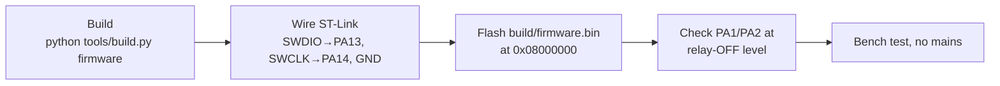

<p align="center">
  
</p>

<p align="center">
  
  
  
  
</p>

# Smart Bathroom Light & Exhaust Fan Controller

Keep using your **existing PIR sensor**, but replace its fixed delay with a small microcontroller that runs **two independent timers**:

| Output | Turns ON | Turns OFF |
|---|---|---|
| 💡 Light | on motion | **7 min** after the most recent motion |
| 🌀 Exhaust fan | on motion | **10 min** after the most recent motion |

Every new motion restarts both countdowns. The light turning off never turns the fan off. Change the times in one file: [`include/config.h`](include/config.h).

> ⚠️ **Honest limitation:** a PIR cannot reliably detect a completely *still* person. The longer 7-minute window gives you far more margin than a short PIR delay, but it is not a guarantee.

## ▶ How it works (animated)

<p align="center">
  
</p>

Example: motion at 0:00 and again at 4:00 → light off at 11:00, fan off at 14:00.

## 🔌 Connections

<p align="center">
  
</p>

| Signal | GD32 pin |
|---|---|
| PIR output | **PA0** (input, pull-down) |
| Light relay input | **PA1** |
| Fan relay input | **PA2** |
| Debug text (optional) | PA9 (TX, 9600 baud) |
| ST-Link programming | PA13 (SWDIO), PA14 (SWCLK), GND |

Detailed drawing with the 230 V side: [`docs/wiring_diagram.svg`](docs/wiring_diagram.svg). Full notes: [`docs/hardware_design.md`](docs/hardware_design.md).

> 🛑 **Safety:** keep the low-voltage side and the 230 V side separate. No mains on breadboards. Do all bench tests with **no mains**, and have the mains wiring done or checked by a qualified electrician.

## ⚡ Flash it

<p align="center">
  
</p>



1. **Build** (needs Python plus `arm-none-eabi-gcc`, or just `pip install ziglang`):
   ```bash
   python tools/build.py firmware
   ```
2. **Wire an ST-Link V2:** SWDIO → PA13, SWCLK → PA14, GND → GND (3.3 V only if the board is not otherwise powered).
3. **Flash** with STM32CubeProgrammer (`build/firmware.bin` at `0x08000000`) or OpenOCD:
   ```bash
   openocd -f interface/stlink.cfg -f target/stm32f1x.cfg -c "program build/firmware.elf verify reset exit"
   ```
4. Measure PA1 and PA2: both must be at the relay-**OFF** level (3.3 V for active-LOW modules, 0 V for active-HIGH).

Recovery steps and driver notes: [`docs/programming.md`](docs/programming.md).

## 🧭 How to use

1. Power up. For the first 60 s the controller ignores the PIR (PIR modules output junk while warming up). Relays stay OFF.
2. Walk in: light and fan switch ON.
3. Move again at any time: both countdowns restart.
4. Stop moving: light goes off after 7 min, fan after 10 min (from the last motion).
5. If the relays act inverted, flip `RELAY_ACTIVE_LOW` in `config.h` and re-flash.

Set the PIR's own hold-time dial to its **minimum** so the microcontroller timers decide the delay.

Settings in [`include/config.h`](include/config.h): `LIGHT_TIMEOUT_MS`, `FAN_TIMEOUT_MS`, `PIR_ACTIVE_HIGH`, `RELAY_ACTIVE_LOW`, pins, `PIR_WARMUP_MS`, `PIR_DEBOUNCE_MS`, `PIR_STUCK_HIGH_MS`.

## 🧪 Tests

```bash
python tools/build.py test
```
51 checks × 4 configurations (relay active-LOW/HIGH × PIR active-HIGH/LOW): startup OFF, timeouts at the exact boundary, independent timers, repeated motion, PIR held HIGH, reset while energised, 32-bit tick rollover. Step-by-step bench plan: [`docs/test_plan.md`](docs/test_plan.md).

## 📊 Project status (honest)

| Item | State |
|---|---|
| Control logic + unit tests | ✅ passing on PC |
| Firmware compiles for Cortex-M3 (~1 KB) | ✅ |
| GD32 register addresses, clock default | ⚠️ not yet checked against the official manual |
| Running on real hardware | ❌ not tested yet |
| PIR / relay module specifics | ❓ configurable, unconfirmed |

## 🗂 Layout

```
include/config.h        all settings, pins, polarity
src/controller.[ch]     pure timer logic (no hardware)
src/app.[ch]            PIR/relay polarity, safe start-up
src/hal_gd32f103.c      GD32 register-level hardware layer
tests/                  PC tests with a fake hardware layer
tools/build.py          build + test, no make needed
docs/                   design, wiring, programming, test plan
```

## Not included (on purpose)
No Wi-Fi, Bluetooth, mmWave, display or cloud. Manual-override button and status LEDs are planned but not implemented.

---
<sub>Part of [ElectroIoT](https://github.com/ElectroIoT) · always verify hardware ratings before connecting mains loads.</sub>
