<p align="center">
  
</p>

<p align="center">
  
  
  
  
</p>

# Smart Bathroom Light & Exhaust Fan Controller

Keep using your **existing PIR sensor**, but replace its fixed delay with a small microcontroller that runs **two independent timers**:

| Output | Turns ON | Turns OFF |
|---|---|---|
| 💡 Light | on motion | **7 min** after the most recent motion |
| 🌀 Exhaust fan | on motion | **10 min** after the most recent motion |

Every new motion restarts both countdowns. The light turning off never turns the fan off. Change the times in one file: [`include/config.h`](include/config.h).

> ⚠️ **Honest limitation:** a PIR cannot reliably detect a completely *still* person. The longer 7-minute window gives you far more margin than a short PIR delay, but it is not a guarantee.

## ▶ How it works (animated)

<p align="center">
  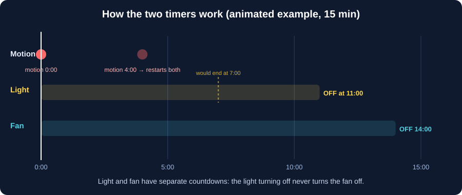
</p>

Example: motion at 0:00 and again at 4:00 → light off at 11:00, fan off at 14:00.

## 👁 PIR module setup (HC-SR501 type)

<p align="center">
  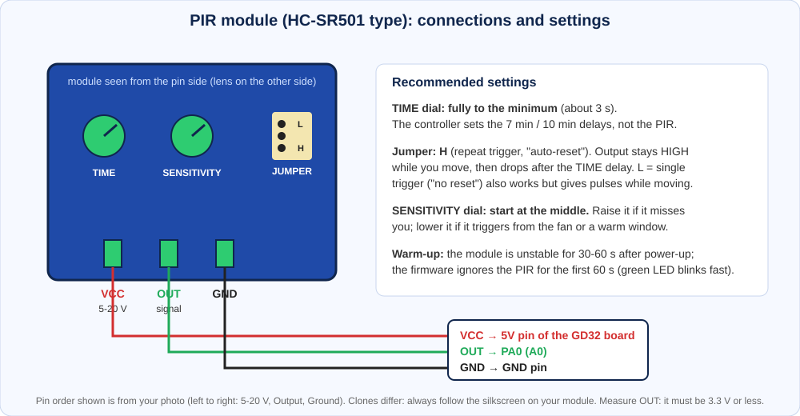
</p>

- **Wire:** VCC (5–20 V) → board **5V** pin, OUT → **PA0 (A0)**, GND → GND.
- **TIME dial:** fully to the **minimum** so the controller, not the PIR, sets the 7/10-minute delays.
- **Jumper:** **H** (repeat trigger). The output stays HIGH while you move.
- **Sensitivity:** start at the middle and adjust.
- **Check:** these modules normally output about 3.3 V, but measure OUT before connecting it to PA0 (it must be 3.3 V or less).

## 📍 Board pinout (Blue Pill style, USB at top)

<p align="center">
  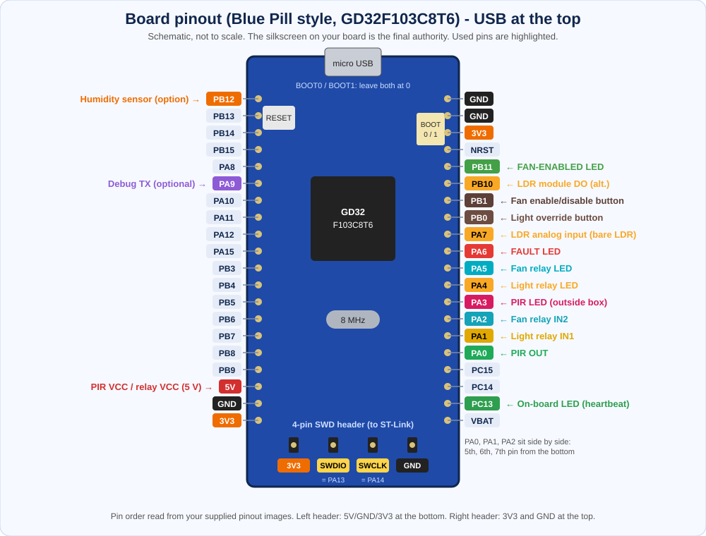
</p>

**Where to wire (USB connector at the top):**
- **PA0 (silk: A0)**: right-hand header, 5th pin from the bottom, PIR output.
- **PA1 (A1)** and **PA2 (A2)**: the next two pins above PA0, relay inputs for light and fan.
- **5V, GND, 3V3**: left-hand header, the bottom three pins (also GND and 3V3 at the top of the right header).
- **PA3 to PA7, PB0, PB1, PB10, PB11**: right header (LEDs, buttons, optional LDR); **PB12**: left header, 1st from the top (optional DHT).
- **PA9 (A9)**: left header, 6th from the top, optional debug TX.
- **PC13**: on-board LED (heartbeat).
- **SWD header** (bottom edge): 3V3, SWDIO, SWCLK, GND, for the ST-Link.

## 🔌 Connections

<p align="center">
  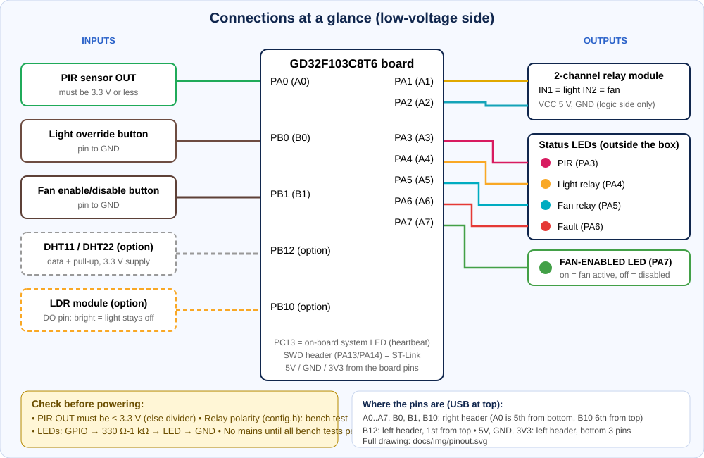
</p>

| Signal | GD32 pin |
|---|---|
| PIR output | **PA0** / A0 (input, pull-down) |
| Light relay input | **PA1** / A1 |
| Fan relay input | **PA2** / A2 |
| System heartbeat LED | PC13 (on-board LED) |
| PIR status LED (outside box) | PA3 / A3 |
| Light relay status LED | PA4 / A4 |
| Fan relay status LED | PA5 / A5 |
| Fault LED | PA6 / A6 |
| Light override button | PB0 / B0 (to GND) |
| Fan enable/disable button | PB1 / B1 (to GND) |
| FAN-ENABLED LED | PB11 / B11 |
| System heartbeat LED (external) | PB13 / B13 |
| Humidity sensor DHT11/DHT22 (optional) | PB12 / B12 |
| Bare LDR + 10 kΩ, analog (optional) | PA7 / A7 (ADC) |
| or digital LDR module DO (optional) | PB10 / B10 |
| Debug text (optional) | PA9 / A9 (TX, 9600 baud) |
| ST-Link programming | PA13 (SWDIO), PA14 (SWCLK), GND |

### Part-by-part wiring to the Blue Pill

One diagram per part, each showing the Blue Pill pin names. (Regenerate with `python tools/gen_part_wiring.py`; the pin map is in [`include/config.h`](include/config.h).)

#### Relays: PA1 (light) and PA2 (fan)
<p align="center">
  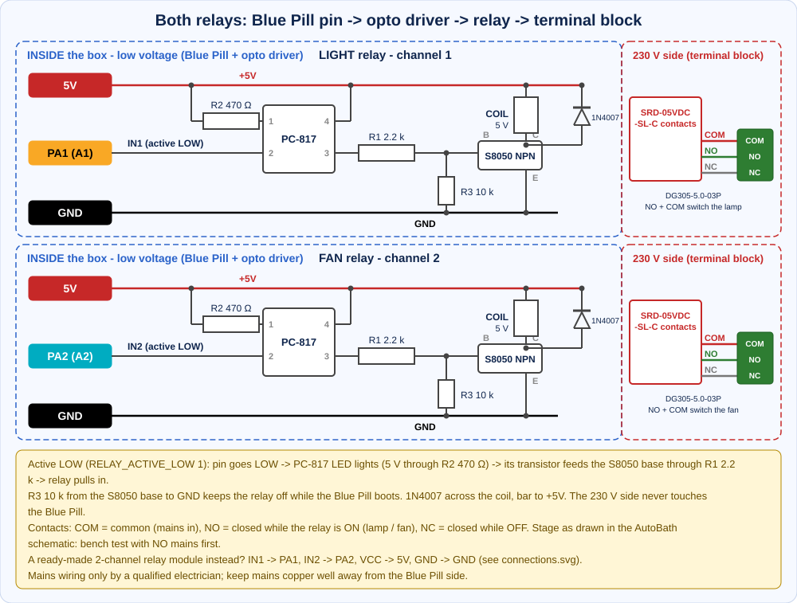
</p>

#### Status LEDs: PA3, PA4, PA5, PA6, PB11, PB13
<p align="center">
  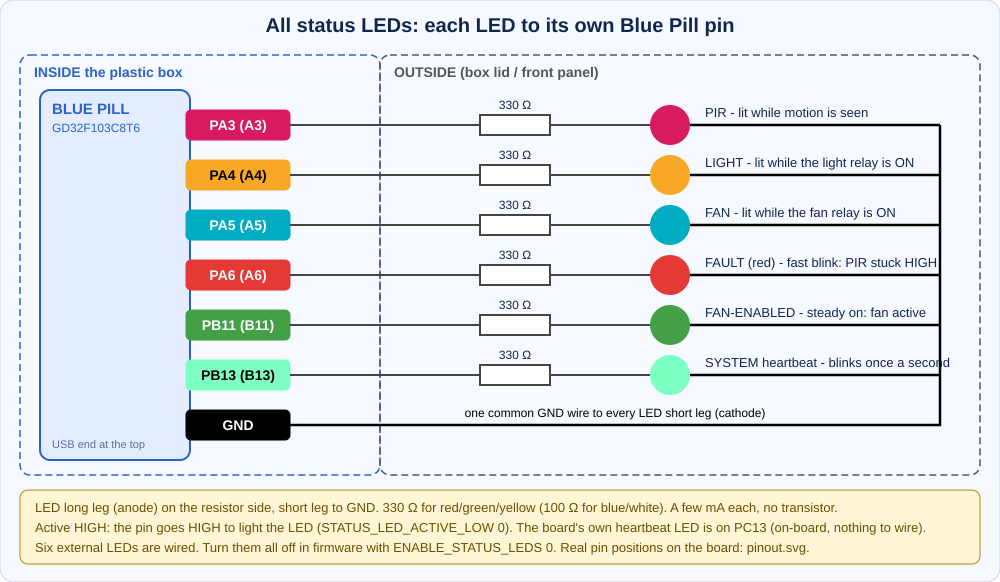
</p>

#### PIR sensor: PA0
<p align="center">
  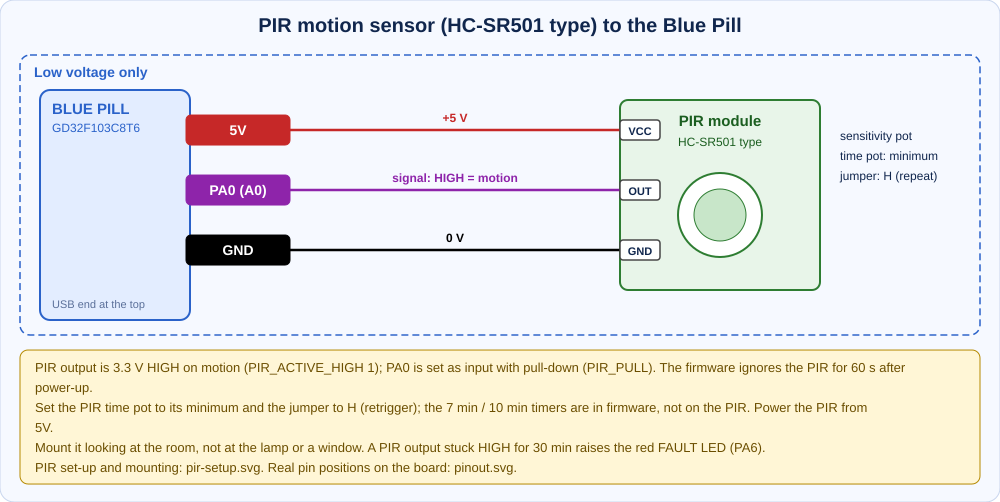
</p>

#### Buttons: PB0 and PB1
<p align="center">
  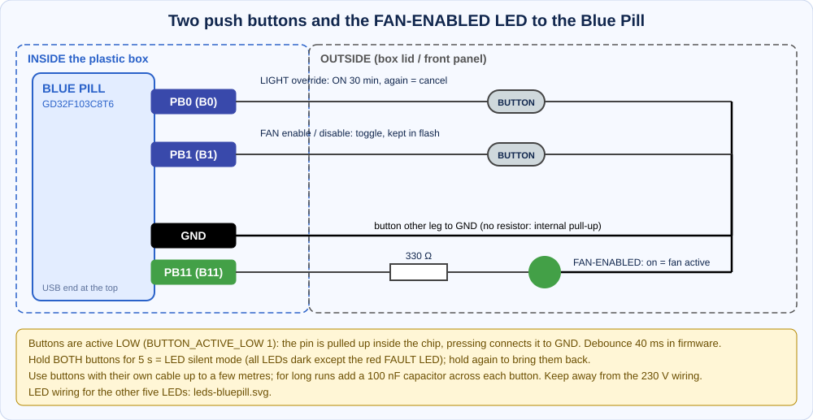
</p>

#### Daylight sensor (LDR): PA7 or PB10
<p align="center">
  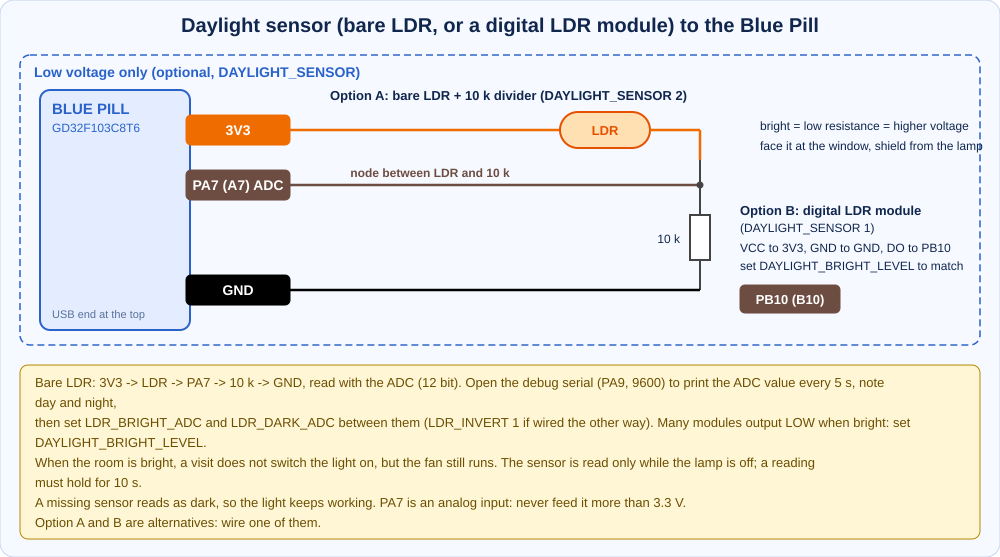
</p>

#### Humidity sensor (optional): PB12
<p align="center">
  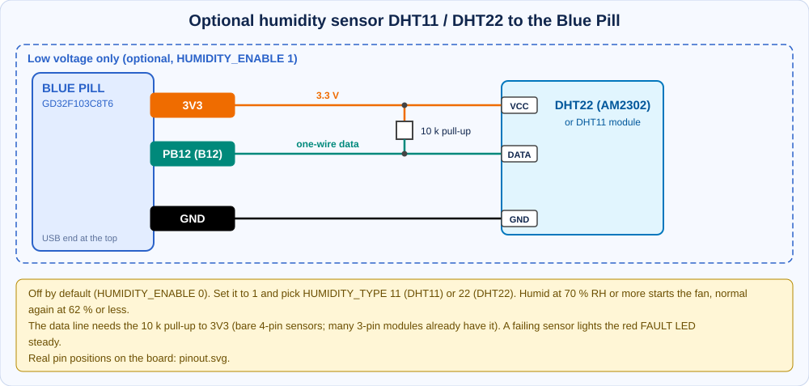
</p>

### Final wiring diagram (complete system, including the 230 V side)

<p align="center">
  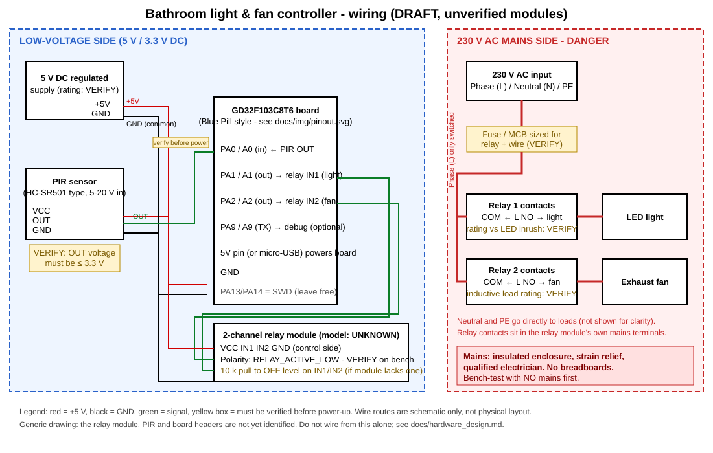
</p>

Open [`docs/wiring_diagram.svg`](docs/wiring_diagram.svg) for the full-size version. Same-named tags (5V, 3V3, GND) are joined. Full notes: [`docs/hardware_design.md`](docs/hardware_design.md).

> 🛑 **Safety:** keep the low-voltage side and the 230 V side separate. No mains on breadboards. Do all bench tests with **no mains**, and have the mains wiring done or checked by a qualified electrician.

## 💡 Status LEDs (outside the box)

<p align="center">
  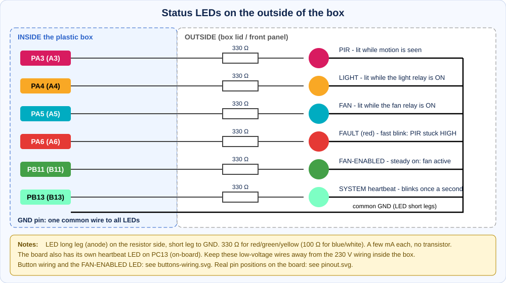
</p>

| LED | Meaning |
|---|---|
| On-board PC13 and the external **PB13** LED | System alive (heartbeat): fast blink during the 60 s warm-up, then a 150 ms blink once per second. Both LEDs blink together. |
| PIR (PA3) | Lit while the PIR reports motion (solid if the PIR output stays HIGH) |
| Light (PA4) | Lit while the light relay is ON |
| Fan (PA5) | Lit while the fan relay is ON |
| Fault (PA6, red) | **Fast blink** (about 4 per second) = the PIR output has been HIGH for 30 minutes (`PIR_STUCK_HIGH_MS`); clears when the PIR goes LOW. **Steady glow** = the humidity sensor is failing (only if `HUMIDITY_SENSOR` is on). Dark = no fault. |
| FAN-ENABLED (PB11, green) | **Steady on** = the fan is enabled and works with the PIR. **Off** = the fan was disabled with its button. It does not blink: it is not the heartbeat. |

To switch all LEDs off except the red FAULT LED (for example for a dark bedroom bathroom), use **LED silent mode**: hold both buttons for 5 seconds (see the features table below). Wire each as GPIO → 330 Ω–1 kΩ resistor → LED → GND. Keep this low-voltage wiring away from the 230 V parts. Turn the external LEDs off with `ENABLE_STATUS_LEDS 0` in `config.h`.

## 🎛 Buttons, fan disable and smart features

<p align="center">
  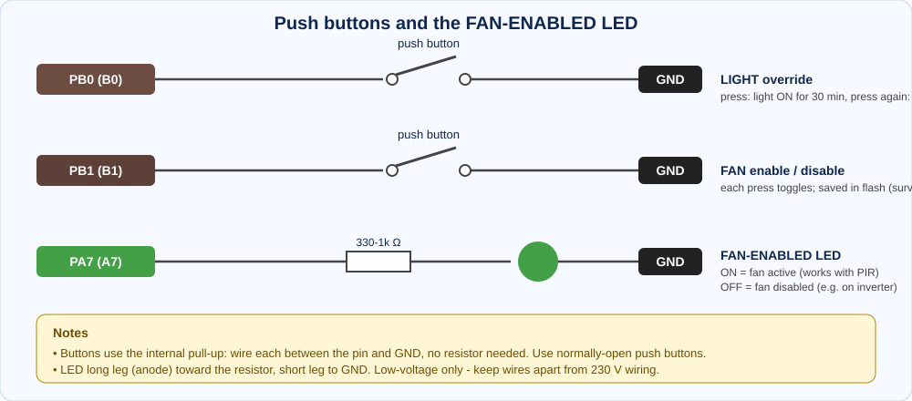
</p>

| Feature | What it does |
|---|---|
| **Warning blink** | 30 s before the light times out it switches OFF for 0.6 s and back ON. If you are sitting still, wave your hand: the 7-minute timer restarts. |
| **Fan start delay** | The fan starts only after the light has been ON for 30 s (set `FAN_START_DELAY_MS`, 0 = immediate). Once started it runs 10 min after the last motion. |
| **Light override button (PB0)** | Press: light ON for 30 min regardless of the PIR (fan keeps its own logic). Press again: cancel. |
| **Fan enable/disable button (PB1)** | Press to toggle. **FAN-ENABLED LED (PB11) lit** = fan active and follows the PIR; **LED off** = fan disabled (light still works). Pressing while the fan runs turns it off at once. The setting is saved in flash and **survives power failure**, so you can disable the fan for days (for example on inverter). |
| **LED silent mode (hold BOTH buttons 5 s)** | Press and hold the two buttons together for **5 seconds**: every LED glows once for about 1.5 s as confirmation, then **all LEDs go dark except the red FAULT LED**, which stays active so a problem is still shown. Hold both buttons for 5 seconds again to bring the LEDs back (they glow once again). The choice is **saved in flash** and survives power loss. The relays and the PIR logic are not affected. Holding both buttons does not trigger the single-button actions. |
| **Watchdog** | If the firmware ever hangs, the chip resets itself within about 4 s and the relays return to OFF. |

All values are in [`include/config.h`](include/config.h). Wire each button between its pin and GND (internal pull-up).

## ☀ Daylight sensor (bare LDR: on in the default config, set `DAYLIGHT_SENSOR 0` if not fitted)

<p align="center">
  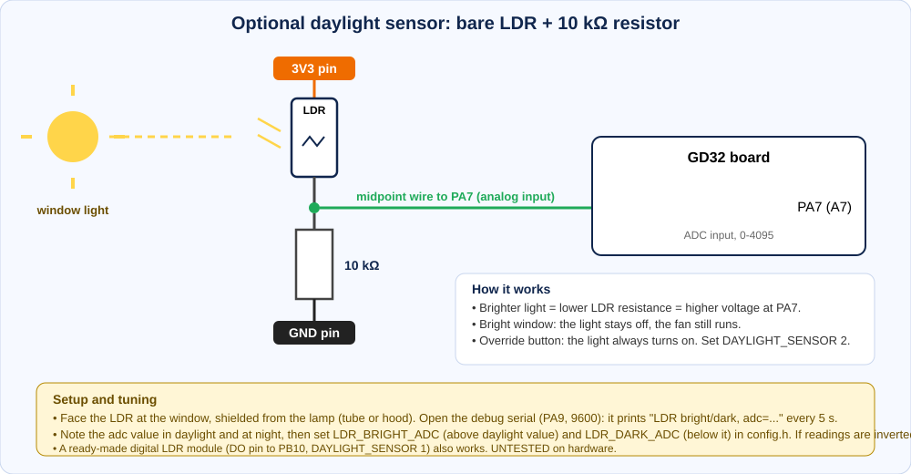
</p>

Set `DAYLIGHT_SENSOR` to `2` for a **bare LDR** (3V3 → LDR → PA7 → 10 kΩ → GND, read with the ADC), or to `1` for a ready-made digital LDR module (DO pin on PB10), in [`include/config.h`](include/config.h). For the bare LDR, open the debug serial (PA9, 9600) which prints the ADC value every 5 s: note the daylight and night values and set `LDR_BRIGHT_ADC` / `LDR_DARK_ADC` between them (`LDR_INVERT 1` if wired the other way). When the room is bright from the window, a visit does **not** switch the light on, but the **fan still starts and runs** on its normal timer. The override button always turns the light on. The sensor is read only while the lamp is off (so the lamp cannot fool it), a reading must hold for 10 s, and a missing sensor reads as dark so the light keeps working. Many modules output LOW when bright: set `DAYLIGHT_BRIGHT_LEVEL` to match. Mount it facing the window and shielded from the lamp.

## 💧 Optional humidity sensor (off by default)

<p align="center">
  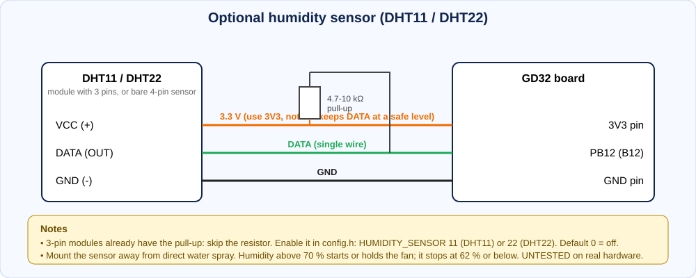
</p>

**Off by default** (no sensor fitted). To use a sensor, open [`include/config.h`](include/config.h), set `HUMIDITY_ENABLE` to `1` and `HUMIDITY_TYPE` to `11` (DHT11) or `22` (DHT22). With `HUMIDITY_ENABLE 0` the feature is completely off: PB12 is not touched and there is no humidity logic.

- **Humid (70 % or more):** the fan starts by itself (even without motion) and is held ON.
- **Back to normal (62 % or less):** a humidity-only run stops; after a visit the normal 10-minute fan timer applies again.
- **Safety:** humidity can hold the fan at most 60 minutes per humid period, and after 3 failed sensor reads in a row the sensor is ignored and the **fault LED glows steadily** (a broken sensor can never hold the fan on).
- The fan enable/disable button still wins: a disabled fan is never started by humidity.
- A reading takes about 4 ms once every 5 s, and is untested on real hardware. A DHT22 is more accurate than a DHT11.

## 🖥 Live test dashboard (see everything working in real time)

<p align="center">
  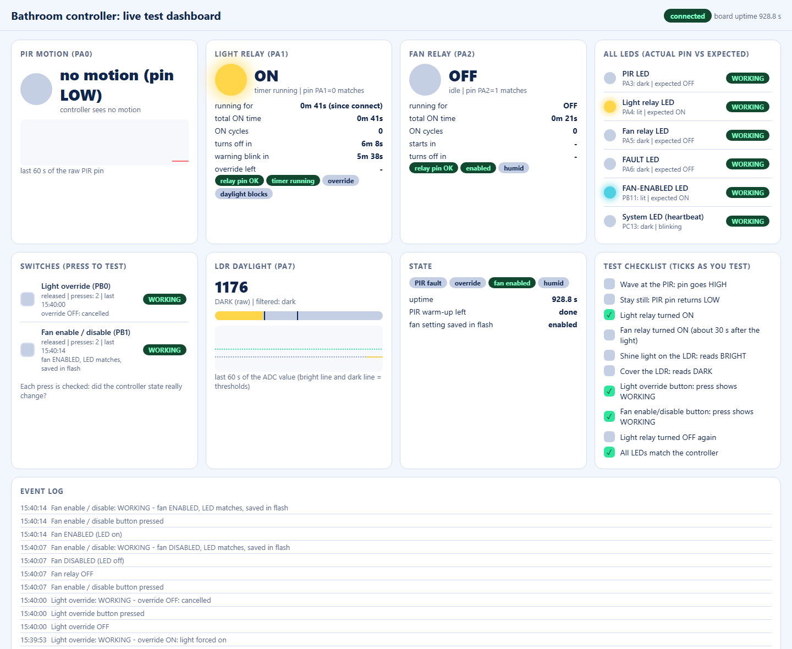
</p>

**Windows: double-click [`BathroomController.bat`](BathroomController.bat) and choose 1.** Or run `python tools/dashboard.py` (or the VS Code task) and open **http://localhost:8765**. It reads the running board through the ST-Link (no serial adapter) and shows:

| Card | What you see |
|---|---|
| **PIR motion** | A glowing light for the raw PIR pin and a 60-second strip chart: wave your hand and watch it light up. |
| **Light and fan relays** | ON or OFF, **how long each has been running**, total ON time, number of ON cycles, the countdown to turn-off, the fan start delay, and a check that the real relay pin matches what the controller wants. |
| **All LEDs** | PIR, light relay, fan relay, FAULT, FAN-ENABLED and the on-board heartbeat LED: lit or dark, expected or not, with a green *WORKING* tag when the pin matches. |
| **Switches** | Both buttons light up while pressed, count the presses, and show **WORKING** only if the press really changed something (override on or off; fan enabled or disabled, LED matching, and the setting **saved in flash**). |
| **LDR** | The ADC value with the bright and dark thresholds and a 60-second chart. |
| **Event log and checklist** | Every change with a timestamp, and a checklist that ticks as you test each input. |

Stop it before flashing (only one program can use the ST-Link at a time). It needs `build/firmware.elf` from the firmware that is flashed.

**Fake fault test (red LED):** `python tools/fault_test.py` (or option 8 in the launcher) sets the "PIR stuck HIGH" fault for 8 seconds so you can see the red FAULT LED blink without waiting 30 minutes. It only sets a flag in the controller: nothing is written to flash and the relays are not touched. For an end-to-end test with the real PIR path, set `PIR_STUCK_HIGH_MS` to `10000` in `include/config.h`, flash, and hold PA0 at 3V3 for 10 seconds (put the value back afterwards).

**LED wiring test:** `python tools/led_test.py` (or option 7 in the launcher) blinks the PIR, light relay, fan relay, FAULT and FAN-ENABLED LEDs one after another so you can see at a glance that each one is wired to the right pin. It works with the dashboard running.

## 🧰 Easiest way: VS Code (no Arduino needed)## 🧰 Easiest way: VS Code (no Arduino needed)

Open the folder in VS Code and use **Terminal → Run Task**: *Test*, *Build firmware*, *Flash to board (ST-Link)*, or *Probe board*. One-time install list and screenshots-free steps: [`docs/vscode.md`](docs/vscode.md). From a terminal the same things are `python tools/build.py test`, `python tools/build.py firmware` and `python tools/flash.py`.

## ⚡ Flash it

<p align="center">
  
</p>

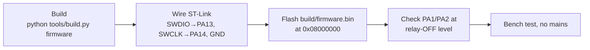

1. **Build** (needs Python plus `arm-none-eabi-gcc`, or just `pip install ziglang`):
   ```bash
   python tools/build.py firmware
   ```
2. **Wire an ST-Link V2** to the board's 4-pin SWD header (labelled 3V3, SWDIO, SWCLK, GND): match each signal by name. Connect 3V3 only if the board is not otherwise powered.
3. **Flash** with STM32CubeProgrammer (`build/firmware.bin` at `0x08000000`) or OpenOCD:
   ```bash
   openocd -f interface/stlink.cfg -f target/stm32f1x.cfg -c "program build/firmware.elf verify reset exit"
   ```
4. Measure PA1 and PA2: both must be at the relay-**OFF** level (3.3 V for active-LOW modules, 0 V for active-HIGH).

Recovery steps and driver notes: [`docs/programming.md`](docs/programming.md).

## 🧭 How to use

1. Power up. For the first 60 s the controller ignores the PIR (PIR modules output junk while warming up). Relays stay OFF.
2. Walk in: the light switches ON at once and the fan starts 30 s later (if the fan is enabled).
3. Move again at any time: both countdowns restart. About 30 s before the light goes off it blinks off for a moment: wave your hand to keep it on.
4. Stop moving: light goes off after 7 min, fan after 10 min (from the last motion).
5. If the relays act inverted, flip `RELAY_ACTIVE_LOW` in `config.h` and re-flash.

Set the PIR's own TIME dial to its **minimum** so the microcontroller timers decide the delay. Buttons: PB0 forces the light on for 30 min; PB1 enables or disables the fan (saved in flash; the FAN-ENABLED LED shows it).

Settings in [`include/config.h`](include/config.h): `LIGHT_TIMEOUT_MS`, `FAN_TIMEOUT_MS`, `PIR_ACTIVE_HIGH`, `RELAY_ACTIVE_LOW`, all pins, `PIR_WARMUP_MS`, `PIR_DEBOUNCE_MS`, `PIR_STUCK_HIGH_MS`, `LIGHT_WARN_BEFORE_MS`, `FAN_START_DELAY_MS`, `LIGHT_OVERRIDE_MS`, `ENABLE_WATCHDOG`, and the options `HUMIDITY_ENABLE` / `HUMIDITY_TYPE` and `DAYLIGHT_SENSOR`.

## 🧪 Tests

```bash
python tools/build.py test
```
470 checks in total, all passing:

| Test set | Checks |
|---|---|
| Core timers (startup OFF, exact timeouts, independent timers, repeated motion, PIR held HIGH, reset while energised, tick rollover, status LEDs) | 65 × 4 polarity variants |
| Features (warning blink, fan start delay, override, fan button + persistence, debounce, watchdog, LED silent mode) | 59 × 2 |
| Humidity option (DHT11 and DHT22) | 30 × 2 |
| Daylight option, digital module | 22 |
| Daylight option, bare LDR (ADC) | 10 |
 Step-by-step bench plan: [`docs/test_plan.md`](docs/test_plan.md).

## 📊 Project status (honest)

| Item | State |
|---|---|
| Control logic + unit tests (470 checks) | ✅ passing on PC |
| Firmware compiles for Cortex-M3 (~3.0 KB) | ✅ |
| Flashed to the real GD32 board; GPIO, clock, SysTick and watchdog read back correctly | ✅ |
| GD32 register addresses | ⚠️ match the running chip for GPIO/clock/watchdog; not checked against the official manual (flash write, ADC and DHT code untested) |
| PIR, relays, buttons, LEDs, optional sensors on the bench | ❌ not tested yet |
| PIR module | HC-SR501 type, output voltage still to be measured |
| Relay module, lamp and fan ratings | ❓ unconfirmed |

## 🧾 Bill of materials (BOM)

Quantities are for **one controller**. *Required* = needed for the basic system, *Optional* = only if you want that feature.

| # | Part | Value / rating | Qty (pcs) | Needed | Notes |
|---|---|---|---|---|---|
| 1 | GD32F103C8T6 "Blue Pill" style board | 3.3 V logic, 4-pin SWD header | 1 | Required | |
| 2 | ST-Link V2 programmer | SWD | 1 | Required | For flashing; remove afterwards |
| 3 | PIR motion sensor | HC-SR501 type, 5–20 V in, 3-pin | 1 | Required | Your existing one; output must be ≤ 3.3 V, else use the divider (#17, #18) |
| 4 | Relay module, 2 channel | 5 V coil, contacts rated for your lamp and fan | 1 | Required | Check the printed rating; set `RELAY_ACTIVE_LOW` |
| 5 | DC power supply | 5 V regulated, 1 A or more | 1 | Required | Board, PIR, relay coils |
| 6 | Resistor, relay input pull | 10 kΩ, 0.25 W | 2 | Required* | *Only if the relay module has no input pull resistors |
| 7 | 3 mm LED | red / green / yellow / orange | 6 | Required for status LEDs | PIR, light relay, fan relay, fault (red), FAN-ENABLED, heartbeat |
| 8 | Resistor, LED | 330 Ω, 0.25 W (100 Ω for blue/white LEDs) | 6 | Required for status LEDs | One per LED |
| 9 | Push button | normally-open, 6 mm tactile or panel mount | 2 | Required for buttons | Light override (PB0), fan enable/disable (PB1) |
| 10 | Bare LDR (photoresistor) | e.g. 5 mm, about 10 kΩ at 10 lux | 1 | Optional | Daylight lockout, `DAYLIGHT_SENSOR 2` |
| 11 | Resistor, LDR divider | 10 kΩ, 0.25 W | 1 | Optional | With the bare LDR |
| 12 | Humidity sensor | DHT22 (or DHT11) | 1 | Optional | Not fitted now. To use it: `HUMIDITY_ENABLE 1`, `HUMIDITY_TYPE 22` or `11`; DHT22 is more accurate |
| 13 | Resistor, DHT pull-up | 10 kΩ (4.7 kΩ to 10 kΩ), 0.25 W | 1 | Optional | 3-pin DHT modules already include it |
| 14 | Digital LDR module | 4-pin with dial | 0 to 1 | Optional | Alternative to #10 and #11 (`DAYLIGHT_SENSOR 1`) |
| 15 | Jumper wires / small wire | Dupont, about 20 cm | 1 set (about 30 pcs) | Required | Low-voltage wiring only |
| 16 | Insulated plastic enclosure | fits all boards with 230 V clearances | 1 | Required | Separate low-voltage and mains areas |
| 17 | Resistor, PIR divider (top) | 10 kΩ, 0.25 W | 1 | Only if PIR output is 5 V | |
| 18 | Resistor, PIR divider (bottom) | 20 kΩ, 0.25 W | 1 | Only if PIR output is 5 V | Gives about 3.3 V from 5 V |
| 19 | Mains terminal blocks | rated for the load current | as needed (about 4 pcs) | Required | Mains side |
| 20 | Fuse or MCB | sized for relay contacts, wire and load | 1 | Required | Check with your electrician |
| 21 | Mains cable + cable glands (strain relief) | correct conductor size for the load | as needed (2 glands) | Required | |
| 22 | Standoffs and screws | M3 | 4 to 8 | Required | Mount the boards firmly |
| 23 | RC snubber or MOV | across the fan relay contacts | 0 to 1 | Optional | Only if the inductive fan load causes sparking or resets |

**Resistor summary**

| Value | Total pcs | Used for |
|---|---|---|
| 330 Ω | 6 | status LEDs (100 Ω instead for blue/white) |
| 10 kΩ | 4 (2 relay pulls, 1 LDR divider, 1 DHT pull-up), plus 1 for the PIR divider if needed | see table above |
| 20 kΩ | 0 to 1 | PIR divider, only if the PIR output is 5 V |

**Tools:** multimeter, small screwdrivers, wire stripper, soldering iron (optional), and a PC with VS Code ([`docs/vscode.md`](docs/vscode.md)).

The PIR is an HC-SR501-type module; the relay module model and your lamp and fan ratings were not known when this list was written. Check them against [`docs/hardware_design.md`](docs/hardware_design.md) before buying or installing, and have a qualified electrician install or inspect the mains side. No prices are listed because they vary by seller.

## 🧩 AutoBath-Light-Fan PCB (planned, EasyEDA)

A custom board is being designed: your Blue Pill plugs into sockets, and the PCB carries the two relays with mains terminals, fuses, a varistor, an on-board 5 V AC-DC module, the LED, button and sensor connectors, and the relay drivers. **Design draft only: not built, not reviewed.** See [`docs/pcb/README.md`](docs/pcb/README.md) for the decisions, [`netlist.csv`](docs/pcb/netlist.csv), [`bom.csv`](docs/pcb/bom.csv), the layout and safety rules, and the staged bring-up plan. On that board the relays are driven by NPN transistors, so set `RELAY_ACTIVE_LOW 0` in `config.h`. 3D models of the Blue Pill (with and without header pins) for the EasyEDA 3D preview are in [`docs/pcb/3d/`](docs/pcb/3d/README.md), with a footprint, symbol and device for EasyEDA Pro and KiCad. The PCB and Blue Pill part files are licensed CC BY 4.0, see [`docs/pcb/LICENSE.md`](docs/pcb/LICENSE.md).

<p align="center">
  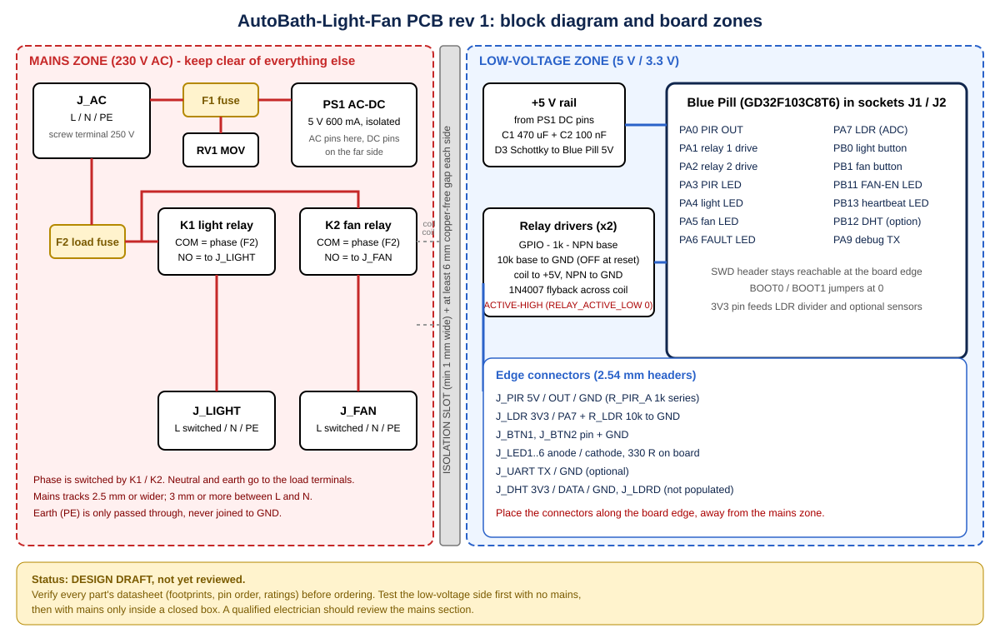
</p>

## 🗂 Layout

```
include/config.h        all settings, pins, polarity, options
src/controller.[ch]     pure timer logic (no hardware)
src/button.[ch]         button debounce
src/humidity.[ch]       DHT decoding and humidity logic
src/daylight.[ch]       daylight filter and ADC thresholds
src/app.[ch]            glue: polarity, LEDs, buttons, safe start-up
src/hal_gd32f103.c      GD32 register-level hardware layer
tests/                  PC tests with a fake hardware layer
tools/build.py          build + test, no make needed
tools/flash.py          flash through ST-Link (OpenOCD)
tools/live_status.py    read live PIR / LDR / timer state through the ST-Link
tools/dashboard.py      live test dashboard in the browser (http://localhost:8765)
tools/led_test.py       blink each status LED in turn (wiring check)
tools/fault_test.py     fake the PIR-stuck fault to test the red LED
BathroomController.bat  Windows launcher: dashboard, tests, build, flash, setup
.vscode/                one-click Test, Build, Flash tasks
docs/                   design, wiring, programming, test plan, images
```

## Not included (on purpose)
No Wi-Fi, Bluetooth, mmWave, display or cloud. The system is standalone.

---
<sub>Part of [ElectroIoT](https://github.com/ElectroIoT) · always verify hardware ratings before connecting mains loads.</sub>
