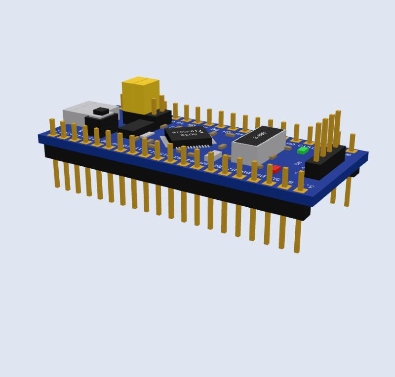
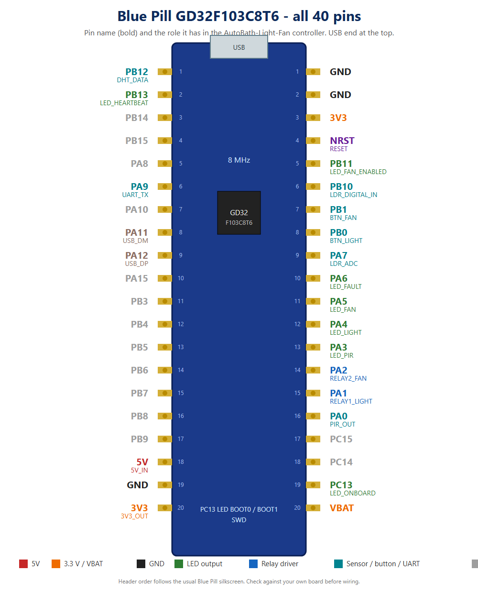

# Blue Pill (GD32F103C8T6 / STM32F103C8T6) part kit: 3D model, footprint, symbol

A drop-in part for anyone who wants to design a carrier board for a Blue Pill style module, in **EasyEDA Pro** or **KiCad**. It has a 3D model (with the silkscreen text built in), a 2 x 20 through-hole footprint and a 40-pin symbol, all with the same pin numbering.





## What is in the box

| What | File | Notes |
|---|---|---|
| 3D model with header pins | `BluePill_GD32F103C8T6_WITH_header_*` | **solder-in** version: header plastic sits on the PCB, pins go down through it (like any through-hole part) and stick out only 1 mm above the module |
| 3D model without header pins | `BluePill_GD32F103C8T6_WITHOUT_header_*` | use when your own socket / header part already draws the pins |
| EasyEDA / EAGLE library | [`../eda/AutoBath_parts_and_BluePill.lbr`](../eda/) | Blue Pill symbol, footprint `BLUEPILL_40P` and device, plus the other parts of the AutoBath board |
| EasyEDA Pro device export | [`../easyeda/`](../easyeda/) | `BluePill_GD32F103C8T6_device_rev3.elibz2` with device, symbol and footprint (3D model added separately, see its README) |
| KiCad footprint + symbol | [`../kicad/`](../kicad/) | `.kicad_mod` points at the `_kicad_scale.wrl` model |
| Pin picture | `BluePill_pinout_all_pins.png` / `.svg` | every pin name and its role in this project |

Model formats: `..._mm.wrl` (VRML, millimetres), `..._kicad_scale.wrl` (VRML in KiCad's 2.54 scale), `..._obj.zip` (OBJ + MTL for EasyEDA Pro, titles end in `_rev3`).
Extras in [`extras/`](extras/): one male header strip, one female socket strip, the module plugged into two sockets (only this one floats 11 mm high), and a tagged pin reference model (not for a PCB).

## Facts used, and where they come from
These were checked against a top-down photo and community data on 2026-10-15. None of it is an official drawing.
- **Size:** about 53.3 x 22.5 mm. [stm32-base.org](https://stm32-base.org/boards/STM32F103C8T6-Blue-Pill.html) lists 23 x 53 mm; scaling a top-down photo of the board by its 2.54 mm pin pitch gives 53.2 x 22.2 mm. Treat width as 22.5 mm +- 0.5 mm.
- **Row spacing: 15.24 mm (0.6 in).** From the same photo (the two pad rows are 0.6 in apart); two independent community KiCad footprints (`l3VGV/blue-pill-kicad`, `DiamondTacoSoup/KiCad_BluePill_STM32F103C8T6_Schematic_Footprint`) use the same value. An earlier version of this kit assumed 20.32 mm, which was wrong.
- **Pin order:** header 1 runs VBAT, C13, C14, C15, A0 ... B11, NRST, 3.3, G, G; header 2 runs 3.3, G, 5V, B9 ... B12 (stm32-base.org, and the silkscreen in the photo).
- **Layout:** micro-USB at the end with B12 and GND, SWD header and the 8 MHz crystal at the end with 3.3 V and VBAT, BOOT jumpers and the reset button next to the USB connector. Silkscreen names sit outside the pad rows. Square pads mark VBAT and 3.3 V on the real board.

## Using it
### EasyEDA Pro
1. File, Import, EAGLE, pick `../eda/AutoBath_parts_and_BluePill.lbr`, option **Extract Libraries**, tick all, Confirm. The device `BLUEPILL_GD32F103C8T6` appears under Library, Device, Personal (and in the Shift+F search).
2. Add a 3D model: **New 3D Model**, pick one of the `_obj.zip` files, tick the model, Save. (The title must be unique in your library, otherwise EasyEDA says "Duplicate title".)
3. Open footprint `BLUEPILL_40P` in the footprint editor, 3D Model, Personal list, pick the model, Confirm, Save. The 3D view shows the module standing in the pads.

### KiCad
Copy `../kicad/BluePill_GD32F103C8T6.kicad_mod` into a `.pretty` library next to `BluePill_GD32F103C8T6_WITH_header_kicad_scale.wrl`, add the `.kicad_sym` to a symbol library, and set the model path if you move the files.

## Pin numbering
Pins 1 to 20 are on the right, bottom to top (B12 up to 3.3). Pins 21 to 40 are on the left, bottom to top (GND up to VBAT). In the footprint, pin 1 and pin 21 are at the same end (the USB end of the model), pad 1 is square.

## Model coordinates
Origin is the top surface of the host PCB under the module, board centre. USB at **+X**; the row with B12 at **+Y**. The module is a solder-in part: the header plastic stands on the PCB (z 0 to 2.5 mm), the module board is at z 2.5 to 4.1 mm, the pin tips end 1 mm above it, and the pins go down to z = -3.2 mm, through a 1.6 mm PCB. No Z offset is needed in the 3D model manager.

## Still unverified
- Row spacing and board size are measured from a photo (about +-0.4 mm). Put calipers on your own board before sending anything to a board house; edit the constants at the top of [`tools/gen_bluepill_3d.py`](../../../tools/gen_bluepill_3d.py) and [`tools/gen_eagle_schematic.py`](../../../tools/gen_eagle_schematic.py) and run them again.
- Header plastic height (2.5 mm), pin length below it (3.2 mm) and the 1 mm pin tip are chosen values, not measured; a real Blue Pill with long pins sticks out more.
- Boards from different makers differ slightly (clones, USB connector style, component placement).

## Regenerate
```bash
python tools/gen_bluepill_3d.py          # 3D models
python tools/gen_eagle_schematic.py      # EasyEDA / EAGLE library and the AutoBath schematic
python tools/gen_kicad_bluepill.py       # KiCad footprint and symbol
python tools/gen_bluepill_pinpic.py      # pin picture (SVG)
```

## License
CC BY 4.0: free to use, change and sell with credit. See [`../LICENSE.md`](../LICENSE.md).
