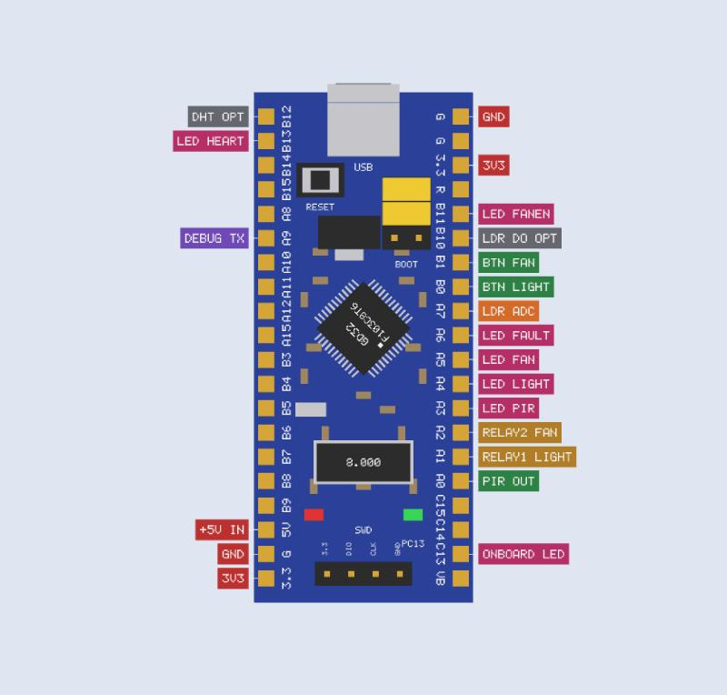

# Blue Pill (GD32F103C8T6) 3D models for EasyEDA, KiCad and other tools

Two ready-to-use models of a Blue Pill style board, **one with the pin headers and one without**, with the silkscreen text (pin names, RESET, BOOT, PC13, SWD) built into the 3D shape.

| | Without header pins | With header pins |
|---|---|---|
| Preview |  |  |
| EasyEDA / VRML (mm) | `BluePill_GD32F103C8T6_WITHOUT_header_mm.wrl` | `BluePill_GD32F103C8T6_WITH_header_mm.wrl` |
| KiCad scale VRML | `..._WITHOUT_header_kicad_scale.wrl` | `..._WITH_header_kicad_scale.wrl` |
| OBJ + MTL zip | `..._WITHOUT_header_obj.zip` | `..._WITH_header_obj.zip` |
| Contains | board, gold pads, GD32F103C8T6 chip with marking, 8 MHz and 32.768 kHz crystals, micro-USB, reset button, BOOT0/BOOT1 jumpers, regulator, LEDs, SWD header, small parts, white silkscreen | everything on the left **plus both 1x20 male pin headers** (black plastic under the board, long gold pins down into the socket, tips above the board) |

**Which one to use?** Use **WITH header** for a pretty 3D preview of the complete module. Use **WITHOUT header** when your own footprint or library part already draws the pin headers or sockets, so they are not doubled.

## Reference extras (`extras/`)
- `PinHeader_1x20_male_strip_mm.wrl`: one male header strip, to place once per row yourself.
- `Socket_1x20_female_strip_mm.wrl`: one female socket strip.
- `BluePill_WITH_header_and_sockets_assembly_mm.wrl`: the module plugged into two sockets (assembly view).
- `BluePill_WITH_header_pinout_tags_reference_mm.wrl`: the module with colour-coded **project pin tags** (PIR OUT, RELAY1 LIGHT, LED FAULT, and so on) beside the headers, for pictures. The tags stick out beyond the board, so do not use it on a PCB.



## Adding a model in EasyEDA (Standard edition)
1. Top menu **New → PCB 3D Lib**, then import `..._mm.wrl` (or the `_obj.zip`: EasyEDA wants OBJ zipped with its MTL; file extensions must be lowercase).
2. In your PCB or footprint open **Tools → 3D Model Manager**, select the footprint, pick the imported model on the right.
3. Match the model outline to the footprint (width, height, X, Y, rotation), then click **Update**, and check the **3D preview**.
4. If the model comes out 2.54 times too big or too small, use the `_kicad_scale.wrl` version instead.

(Steps from EasyEDA's own Standard-edition guide. EasyEDA Pro and other tools use different menus.)

## Model coordinates and assumptions
- Origin: the **top surface of the host PCB** under the module, at the centre of the board. USB connector at **+X**, the left header (looking down with USB at the top) at **+Y**.
- The board floats **11 mm** above the origin (8.5 mm socket + 2.5 mm header plastic), so no Z offset is needed.
- **These are approximate models, not official drawings.** Measure your own board and edit the constants at the top of [`tools/gen_bluepill_3d.py`](../../../tools/gen_bluepill_3d.py), then run it again:
  - board **53.34 x 22.86 mm** (2.1 x 0.9 in),
  - header row spacing **20.32 mm (0.8 in)** (the 22.86 mm figure is the board width: measure the row spacing on your board),
  - socket height **8.5 mm**.

## Regenerate
```bash
python tools/gen_bluepill_3d.py
```
All files in this folder are produced by that one script (pure Python, no extra packages).

## License
Not chosen yet. A common choice for models like these is **CC0 1.0** (public domain) or **CC BY 4.0**. Add the licence you want before you publish.
