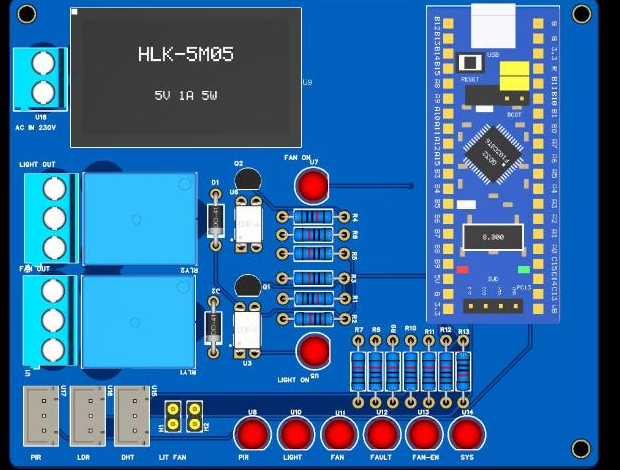
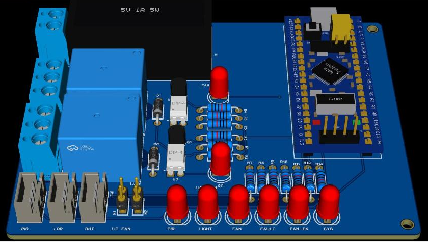

# AutoBath-Light-Fan PCB v1 (design files)

Custom 100 x 80 mm, 2-layer board for the bathroom light (7 min) and exhaust fan (10 min) controller. A GD32F103C8T6 Blue Pill is soldered on, two **opto-isolated** relays switch the lamp and fan, and an HLK-5M05 makes 5 V from mains.

> **Status: designed in EasyEDA, DRC clean, NOT built or tested.** (The firmware has been tested by the author on their own build, not on this PCB.) The mains side must be checked by a qualified electrician. See "Checked / not checked" below.

## Files
| File | What |
|---|---|
| [`AutoBath-Light-Fan_gerber.zip`](AutoBath-Light-Fan_gerber.zip) | Gerber + drill files, ready for a PCB maker (2 layers) |
| [`AutoBath-Light-Fan.epro2`](AutoBath-Light-Fan.epro2) | full EasyEDA Pro project (schematic + PCB): File, Open |
| [`AutoBath-Light-Fan_schematic.pdf`](AutoBath-Light-Fan_schematic.pdf), [`.svg`](AutoBath-Light-Fan_schematic.svg) | schematic |
| [`AutoBath-Light-Fan_BOM.csv`](AutoBath-Light-Fan_BOM.csv) | bill of materials (LCSC numbers as set in the project) |
| [`AutoBath-Light-Fan_nets.csv`](AutoBath-Light-Fan_nets.csv), `.tel` | every net and its pins |

## Silkscreen
Top side: `PIR LDR DHT` (3-pin sensor headers: 1 GND, 2 signal, 3 supply), `LIT FAN` (button headers), LEDs `PIR LIGHT FAN FAULT FAN-EN SYS`, `LIGHT ON` / `FAN ON` (opto indicator LEDs), `LIGHT OUT` / `FAN OUT` (relay terminals) and `AC IN 230V`. Bottom side: a pin legend (PA0 PIR, PA1 light relay, PA2 fan relay, PA7 LDR, PB12 DHT, PB0 light button, PB1 fan button, LED pins PA3 PA4 PA5 PA6 PB11 PB13).

## Pin map
Same as [`include/config.h`](../../../include/config.h): PA0 PIR, PA1 light relay (active LOW), PA2 fan relay (active LOW), PA3 to PA6 + PB11 + PB13 LEDs, PA7 LDR, PB0 / PB1 buttons, PB12 DHT. Set `RELAY_ACTIVE_LOW 1` (opto stage: pin LOW = relay ON). Part-by-part wiring: [`docs/img/*-bluepill.svg`](../../img/).

## Design rules used
Default clearance 6 mil. The six mains nets (relay contacts and AC) use a **3 mm** clearance rule (`mains3mm`). GND is a copper pour on both layers, with a **no-copper region over the relay contact area** (both layers).

## Checked / not checked
- Checked: schematic DRC 0 errors; PCB DRC 0 errors with the 3 mm mains rule; every net routed; 3D view looks right.
- **Not done:** no fuse on the AC input (your decision; the HLK-5M05 is believed to have a built-in varistor, not verified against its datasheet); no milled isolation slot between mains and low voltage (the layout is mixed, a slot would cut tracks); mains tracks are not widened; parts and LCSC numbers still need your final check; this PCB is not built, powered or tested (firmware was tested separately on the author's own build).
- Blue Pill pin 3D model and HLK-5M05 dimensions come from [EasyEDA-3D-Parts](https://github.com/ElectroIoT/EasyEDA-3D-Parts) (not measured on real parts).
- Before powering: read [`../../programming_on_custom_pcb.md`](../../programming_on_custom_pcb.md). Never plug USB while mains is connected.

Licence: CC BY 4.0, credit ElectroIoT.
