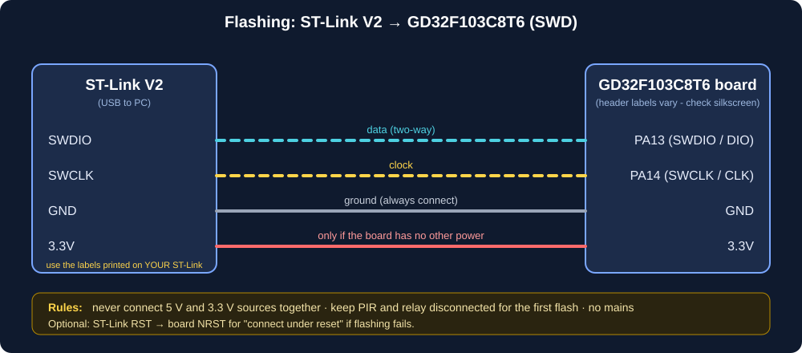

# Programming the board

> **Not tested on real hardware.** The steps below are the standard approach for Cortex-M3 boards; items marked ⚠️ are specific to GD32 and unverified.

## Do I need an ST-Link?
Plan on **yes**. Do not assume the board's USB connector programs it: on most "minimum system" boards it only supplies power (or is wired to the MCU's USB pins for your own USB code). ⚠️ GD32F103 has a built-in serial bootloader (BOOT0 high + UART) which is a no-probe fallback, but it needs a USB-to-serial adapter, so a probe is simpler. A "ST-Link V2" clone (about the size of a USB stick) works over SWD.

## Wiring (SWD)


| ST-Link | Board |
|---|---|
| SWDIO | **PA13** (header often labelled DIO / SWDIO) |
| SWCLK | **PA14** (CLK / SWCLK) |
| GND | GND |
| 3.3V | 3.3V (only if the board is **not** otherwise powered; never connect 5 V and 3.3 V sources together) |
| RST (optional) | NRST |

Many boards have a 4-pin SWD header in this order. Check the silkscreen.

## Toolchain
Install either:
* **Arm GNU Toolchain** (`arm-none-eabi-gcc`) — recommended; or
* `pip install ziglang` (what this project was built with here: no other install needed).

Build:
```
python tools/build.py test        # host unit tests
python tools/build.py firmware    # -> build/firmware.elf and build/firmware.bin
```
`build.py` uses `arm-none-eabi-gcc` if it is on PATH, otherwise Zig.

## Flashing (pick one)
**OpenOCD** (⚠️ `stm32f1x` target usually works with GD32F103 but may complain about the chip ID; if so, a vendor-supplied config or `-c "set CPUTAPID 0"` is the usual workaround):
```
openocd -f interface/stlink.cfg -f target/stm32f1x.cfg ^
        -c "program build/firmware.elf verify reset exit"
```
**STM32CubeProgrammer / ST-LINK Utility** (⚠️ may reject GD32 IDs on newer versions). **GigaDevice GD-Link / GD32 ISP tools** are the vendor-supported alternative.

Debugging: `openocd ...` then `arm-none-eabi-gdb build/firmware.elf` → `target extended-remote :3333`. Debug text is on PA9 (9600 8N1) via a 3.3 V USB-serial adapter (RX ← PA9, GND common); never connect it to the relay side.

## Drivers
* ST-Link V2 clones: ST's ST-LINK driver (Windows). For OpenOCD on Windows you may need to bind `WinUSB` using Zadig if OpenOCD cannot open the probe.

## Recovery if programming fails
1. Check wiring, common GND, and that the board is powered once.
2. Hold the board in reset (NRST to GND) and start "connect under reset".
3. Set **BOOT0 = HIGH** (jumper), reset, program via SWD or the UART bootloader, then return BOOT0 to LOW.
4. Remove everything on PA13/PA14 (they must not be driven by other circuits).
5. If the chip appears read-protected: "mass erase / unlock" in the tool (this erases flash).
6. As a last resort, try a second ST-Link / lower SWD clock (e.g. `adapter speed 100`).
